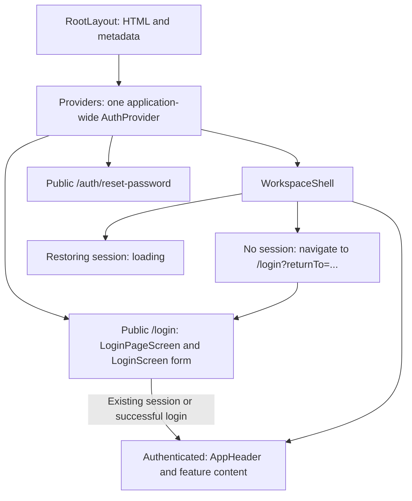

# OmniDesk Web

OmniDesk's frontend is built with Next.js 16 and React 19. The codebase uses **thin route components, feature modules, and shared UI and infrastructure** to separate URL structure from feature implementation. A feature does not necessarily require its own route.

## Development and Validation

Run these commands from the repository root:

```powershell
pnpm dev:web
pnpm --filter web lint
pnpm --filter web test
pnpm --filter web build
```

The development server runs at `http://localhost:3002`, with the login page at `http://localhost:3002/login`. The default API endpoint is `http://localhost:3000/api/v1`; the Socket.IO endpoint is `http://localhost:3000/notifications`.

Follow the [root README](../../README.md) to configure the API, worker, and supporting services. Public configuration is read through [app-config.ts](src/lib/app-config.ts) and can be overridden in `apps/web/.env.local`. Unit tests require Node.js 22 with TypeScript type stripping, consistent with the Docker and CI environments.

## Project Structure and Ownership

```text
src/
  app/
    layout.tsx
    providers.tsx
    icon.svg
    globals.css
    (public)/
      login/page.tsx
      auth/reset-password/page.tsx
    (workspace)/
      layout.tsx
      workspace-shell.tsx
      page.tsx
      dashboard/page.tsx
      user/page.tsx
      dead-letter/page.tsx
  features/
    auth/
      auth-provider.tsx
      auth-navigation.ts
      auth-loading-screen.tsx
      login-page-screen.tsx
      login-screen.tsx
      forgot-password-modal.tsx
      reset-password-screen.tsx
    inbox/
      inbox-screen.tsx
      inbox-components.tsx
      inbox-model.ts
      hooks/
      components/
      conversation-list/
      conversation-detail/
      filters/
      reply/
      side-panel/
      utils/
    dashboard/
      dashboard-screen.tsx
    users/
      users-screen.tsx
    dead-letter/
      dead-letter-screen.tsx
  components/
    layout/
      app-header.tsx
    ui/
      brand-logo.tsx
      loading-indicator.tsx
  lib/
    api-client.ts
    api-types.ts
    app-config.ts
    realtime-client.ts
    use-realtime.ts
```

| Location | Responsibilities | Keep elsewhere |
|---|---|---|
| `app/` | Routes, metadata, provider composition, and layouts for route groups | Forms, data-loading state, and substantial feature UI |
| `features/<name>/` | Feature screens, hooks, models, components, and behavior | Dependencies on `app/`; application-wide headers |
| `components/layout/` | Shared headers and layout UI | Session checks and feature orchestration |
| `components/ui/` | Small, reusable UI components without domain-specific behavior | API calls, session state, and ticket logic |
| `lib/` | HTTP client, realtime transport, configuration, and shared API contracts | Screens, routes, and authentication workflows |

`features/auth` owns authentication UI and session state; `lib/api-client.ts` owns HTTP and cookie transport. `AuthProvider` therefore belongs to the auth feature even though other features consume it. `app/providers.tsx` composes providers at the root without duplicating authentication state.

`features/inbox/components` contains inbox-specific UI. The application header lives in `components/layout/app-header.tsx` because it is shared across workspace pages. `inbox-components.tsx` exports only inbox UI; it does not re-export authentication components or the application header.

## Branding and Static Assets

The application logo is [public/brand/omnidesk_logo.svg](public/brand/omnidesk_logo.svg), served at `/brand/omnidesk_logo.svg`. Both the symbol and wordmark use **`#EE0033`**, matching the application's accent color. The original paths are preserved, with a tighter viewBox around the wordmark and a transparent background. The [original PNG](public/brand/omnidesk_logo.png) is retained for reference. Store branding assets outside the repository root and feature directories.

[BrandLogo](src/components/ui/brand-logo.tsx) provides consistent branding for the header, login, and password reset screens. It uses `object-contain` within an approximately 4:1 frame to preserve the full wordmark's proportions. The SVG is served directly without raster image optimization; it does not require `dangerouslyAllowSVG`, CSS cropping, or blend modes.

[app/icon.svg](src/app/icon.svg) supplies the browser tab icon. It uses the logo's first four symbol paths, a transparent background, and the same `#EE0033` color. Next.js generates the icon metadata automatically, without `ImageResponse`, PNG file reads, or raster crop coordinates. Update the icon whenever the logo's symbol or color changes.

## Routes and Layouts

| URL | Route file | Screen |
|---|---|---|
| `/` | `app/(workspace)/page.tsx` | `features/inbox/inbox-screen.tsx` |
| `/dashboard` | `app/(workspace)/dashboard/page.tsx` | `features/dashboard/dashboard-screen.tsx` |
| `/user` | `app/(workspace)/user/page.tsx` | `features/users/users-screen.tsx` |
| `/dead-letter` | `app/(workspace)/dead-letter/page.tsx` | `features/dead-letter/dead-letter-screen.tsx` |
| `/login` | `app/(public)/login/page.tsx` | `features/auth/login-page-screen.tsx`, which composes `LoginScreen` |
| `/auth/reset-password?token=...` | `app/(public)/auth/reset-password/page.tsx` | `features/auth/reset-password-screen.tsx` |

`(public)` and `(workspace)` are route groups and do not appear in URLs. `/login` is a dedicated public page. Forgot password remains a modal; there is no `/forgot-password` route. The `users` feature name describes its responsibility, while the user management URL remains `/user`.

[RootLayout](src/app/layout.tsx) defines the HTML structure, global CSS, and metadata. [Providers](src/app/providers.tsx) wraps the application in a single `AuthProvider`. Only the [workspace layout](<src/app/(workspace)/layout.tsx>) wraps pages in `WorkspaceShell`; public login and password reset pages render outside that shell.

The login page provides a `Suspense` boundary for reading the `returnTo` query parameter. `LoginPageScreen` connects session state and navigation, while `LoginScreen` owns the form and forgot-password modal.

Route pages and layouts default to Server Components and compose feature screens or the workspace shell. Components that use state, effects, event handlers, or browser APIs declare `"use client"` at the relevant implementation boundary. Placing a file in `features/` does not determine whether it runs as a Server or Client Component.

## Authentication and Login Navigation



The blocks represent UI components; navigation labels indicate route changes. The branches below `WorkspaceShell` represent mutually exclusive states. Login is a separate route and is not rendered inside the workspace shell.

1. `AuthProvider` restores the session through `apiClient.me`. The HTTP client handles cookie session refresh.
2. The workspace waits for session restoration. If the user is unauthenticated, it uses client-side `router.replace` to navigate to `/login?returnTo=...`. For example, `/dashboard` becomes `/login?returnTo=%2Fdashboard`. The inbox route `/` uses `/login` without an additional parameter. Destination query strings and fragments are preserved when present. Workspace content is not rendered while authentication or navigation is pending.
3. `LoginPageScreen` reads `returnTo` and session state. After a successful login, or when an authenticated user opens `/login`, it calls `router.replace` with a validated destination, defaulting to `/`. A failed login leaves the user on the login page and displays the provider's error. The form calls the provider's login handler rather than managing a separate session.
4. Logout calls the API, clears client session state, and navigates to `/login` without `returnTo`. The shell avoids creating a competing workspace redirect during logout.
5. Password reset reads the token query parameter in a Client Component with a `Suspense` fallback. The page is accessible without a session, and its return-to-login controls point to `/login`. Forgot password remains a modal opened from the login form.

[auth-navigation.ts](src/features/auth/auth-navigation.ts) accepts destinations only on the current workspace paths: `/`, `/dashboard`, `/user`, and `/dead-letter`. External URLs, protocol-relative URLs, authentication or unknown paths, and control characters fall back to `/`. When adding a workspace route, update the allowlist and [unit tests](test/auth-navigation.test.mjs). Destination validation does not replace backend authentication or role-based access control (RBAC).

Route groups organize layouts. The shell controls UI authentication state; the backend enforces authentication and RBAC for API requests. ADMIN role checks for dashboard, users, and dead-letter screens remain within their respective features.

## Dependency Rules and Feature Development

- `app/` composes features and shared UI. Features must not import routes or layouts from `app/`.
- `features/auth` exports `useAuth` and `AuthProvider`. Features that need session state import directly from `@/features/auth/auth-provider`.
- `components/` and `lib/` must not import `app/` or `features/`. ESLint enforces these boundaries for alias imports. Use the `@/` alias across architectural boundaries; do not bypass the restrictions with relative imports.
- Move a component into shared UI only when it has a clear shared responsibility. Components, helpers, and hooks used by one feature belong within that feature.
- The API client remains shared. Endpoints have not been split by feature, and the existing state management and data-fetching libraries remain in place.

To add a workspace screen, create `features/<name>/<name>-screen.tsx`, keep its state, hooks, and UI within that feature, and add a thin route page under `app/(workspace)/`. Add navigation where needed. For example:

```tsx
import { UsersScreen } from "@/features/users/users-screen";

export default function UsersPage() {
  return <UsersScreen />;
}
```

Public workflows with their own URLs belong under `app/(public)/`, with their forms and behavior in the owning feature. A `page.tsx` file inside `features/` does not create a route.

## Validation Checklist

Run lint, unit tests, and a production build. Verify that the route table includes the six application URLs above, route group names do not appear in URLs, and no imports reference `lib/auth-context`, `app/client-layout`, or the previous inbox header location. Unit tests cover query and fragment round trips, `returnTo` encoding, external destination rejection, and authentication redirect loops.

With a suitable backend and test account, verify these workflows:

- Open `/login` directly.
- Open a workspace URL without a session and verify the `returnTo` destination.
- Confirm that failed login stays on `/login` and successful login returns to the requested destination.
- Open `/login` with an existing session and verify the redirect.
- Refresh to restore the session, navigate between workspace pages, and verify that the header and session persist.
- Log out and confirm navigation to `/login`.
- Open password reset with and without a token, and verify its return-to-login links.
- Open the forgot-password modal.
- Verify ADMIN and AGENT behavior, inbox realtime updates, dashboard data, user management, and dead-letter replay.

Use test accounts and data when validating against a live backend. An HTTP 200 response confirms that a route is served; it does not verify client-side authentication navigation.

## Related Documentation

- [System architecture](../../docs/architecture.md)
- [C4 Model](../../docs/c4-model.md)
- [Environment boundaries](../../docs/environments.md)
- [Next.js project structure](https://nextjs.org/docs/app/getting-started/project-structure)
- [Next.js route groups](https://nextjs.org/docs/app/api-reference/file-conventions/route-groups)
